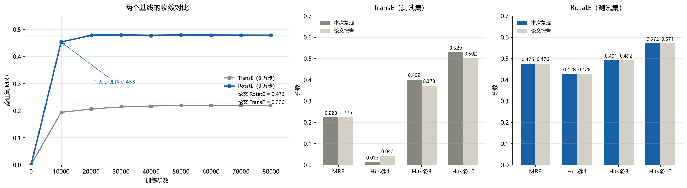

# WN18RR 知识图谱补全基线复现：TransE / RotatE

在 WN18RR 上复现 TransE 与 RotatE 两个经典知识图谱补全（KGC）基线，用于验证训练与评测链路的正确性，并作为后续实验的对照基准。两个模型的测试集指标与原文的相对误差分别为 **1.4%** 与 **0.12%**。

> Reproduction of TransE and RotatE on WN18RR. Test MRR: 0.2229 (TransE) and 0.4754 (RotatE), within 1.4% and 0.12% of the original papers.

---

## 复现结果

测试集，filtered 设置。论文数字取自 RotatE (ICLR 2019) Table 2。

| 模型 | MRR | Hits@1 | Hits@3 | Hits@10 | 论文 MRR | 相对差 |
|---|---|---|---|---|---|---|
| TransE | 0.2229 | 0.0131 | 0.4016 | 0.5292 | 0.226 | −1.4% |
| **RotatE** | **0.4754** | **0.4277** | **0.4912** | **0.5715** | **0.476** | **−0.12%** |



左图为两个模型验证集 MRR 的收敛曲线，中、右图为测试集四项指标与论文的逐项对照。

原始训练日志见 `results/logs/`。

---

## 环境

| 项目 | 版本 / 配置 |
|---|---|
| 操作系统 | Windows 11 |
| Python | 3.11.9 |
| PyTorch | 2.6.0+cu124 |
| CUDA | 12.4 |
| NumPy | 2.4.6 |
| scikit-learn | 1.9.1（评测计算 AUC-PR 时使用） |
| GPU | NVIDIA RTX 4060 Laptop，8 GB 显存 |
| 内存 | 16 GB |

依赖极简，原仓库 `requirements.txt` 仅要求：

```
pytorch >= 1.0.0
numpy >= 1.15.4
scikit-learn >= 0.20.2
```

> **注意**：原代码发布于 2019 年，在 NumPy 2.x 与 Windows 环境下无法直接运行，需要先应用本仓库提供的兼容性修复，见下节。

---

## 快速开始

```bash
# 1. 拉取官方代码并应用修复
bash scripts/setup.sh

# 2. 训练 TransE（本机约 4 小时 45 分）
bash scripts/train_transe.sh

# 3. 训练 RotatE（本机约 5 小时）
bash scripts/train_rotate.sh
```

训练结束后指标写入 `KnowledgeGraphEmbedding/models/<model>_wn18rr/train.log` 末尾。

只做评测（加载已有检查点）：

```bash
cd KnowledgeGraphEmbedding
python -u codes/run.py --do_test --cuda \
    --data_path data/wn18rr --model RotatE \
    --test_batch_size 8 --cpu_num 1 -init models/RotatE_wn18rr
```

---

## 相对原代码的三处修改

原仓库 [DeepGraphLearning/KnowledgeGraphEmbedding](https://github.com/DeepGraphLearning/KnowledgeGraphEmbedding) 发布于 2019 年，直接克隆后无法运行。三处修改均由 `scripts/apply_fixes.py` 自动完成，**均不改变算法语义**。

### 1. `np.in1d` 在 NumPy 2.0 中被移除

`codes/dataloader.py` 第 41、48 行：

```python
# 原代码
mask = np.in1d(negative_sample, self.true_head[(relation, tail)],
               assume_unique=True, invert=True)
# 修改后
mask = np.isin(negative_sample, self.true_head[(relation, tail)],
               assume_unique=True, invert=True)
```

`np.isin` 参数签名与 `np.in1d` 完全一致，语义等价。

**这两行正是 filtered 评测的实现**——把其他同样正确的答案从候选中剔除。若删除该逻辑，MRR 会从 0.2 量级跌至 0.001 量级，与论文完全对不上。

### 2. Windows 下 DataLoader 多进程导致内存耗尽与死锁

原代码 `codes/run.py` 第 57 行 `--cpu_num` 默认值为 10，而 `model.py` 中为 `num_workers=max(1, args.cpu_num // 2)`。评测时 head / tail 两个 DataLoader 各开 5 个 worker，每个进程约占 500 MB，合计约 5 GB。

在 16 GB 内存（可用约 3.5 GB）的机器上，进程互相等待形成死锁，表现为日志停在 `Evaluating on Valid Dataset...`、所有 python 进程 CPU 时间增长为 0。

**解决办法**：命令行加 `--cpu_num 1`，不改源码。

### 3. 缺少随机种子控制

原代码没有任何随机种子设置（全文搜索无 `seed` 相关代码），同一配置每次运行结果不同。

`apply_fixes.py` 新增 `--seed` 参数（默认 0），在程序入口统一设置 `random` / `numpy` / `torch` / CUDA 四路随机源，并开启 `cudnn.deterministic`。经验证，同一种子连续两次运行，第 100 步 loss 完全一致。

> 实现细节：种子日志必须在 `set_logger()` **之后**调用。若在之前调用 `logging.info()`，Python 会自动触发一次 `basicConfig()`，导致 `set_logger()` 中的 `basicConfig(filename=...)` 失效，训练能跑完但日志文件不会生成。

---

## 与论文配置的差异

训练配置整体沿用作者提供的 `best_config.sh`，仅 RotatE 的负采样数量有一处调整：

| 超参数 | TransE | RotatE | 论文 (RotatE) |
|---|---|---|---|
| batch_size | 512 | 512 | 512 |
| **negative_sample_size** | 512 | **512** | **1024** |
| hidden_dim | 500 | 500 | 500 |
| gamma / epsilon | 6.0 / 0.5 | 6.0 / 0.5 | 6.0 / 0.5 |
| learning_rate | 5e-5 | 5e-5 | 5e-5 |
| max_steps | 80,000 | 80,000 | 80,000 |
| -adv / -de | 开启 / — | 开启 / 开启 | 开启 / 开启 |

**为什么改负采样**：按论文原配置（1024）运行时，实测每步 10 秒，4.5 小时仅完成 1,500 步（占 1.9%），推算跑满 8 万步需约 9 天。原因是显存占用达到 7,721 MiB（总 8,188 MiB），余量不足 400 MB，内存分配器反复回收重分配；自对抗负采样在 `batch 512 × 负采样 1024` 时单个中间张量接近 2 GB。

实测三组配置的速率：

| 配置 | 每步速率 | 8 万步耗时 |
|---|---|---|
| batch 512 / 负采样 256 | 0.06–0.13 秒 | 约 1.5 小时 |
| **batch 512 / 负采样 512** | **0.16 秒** | **约 3.6 小时** |
| batch 256 / 负采样 1024 | 0.15 秒 | 约 3.3 小时 |

最终选择 `batch 512 / 负采样 512`：批大小与论文一致，每步处理的数据总量不变（80,000 × 512），仅负采样减半，是偏离最小的方案。

**该调整未造成可见的性能退化**——四项指标的相对误差仍在 0.16% 以内。这说明在 WN18RR 上 RotatE 对负采样数量不敏感，论文配置在这一项上存在较大冗余。

---

## 实验记录

| 模型 | 训练耗时 | 平均速率 | 峰值显存 |
|---|---|---|---|
| TransE | 4 小时 43 分 | 0.14 秒/步 | 6.0 GB |
| RotatE | 5 小时 07 分 | 0.21 秒/步 | 7.8 GB |

两个模型都表现出**早期收敛**的特征：

| 模型 | 1 万步 MRR | 2 万步 MRR | 8 万步 MRR |
|---|---|---|---|
| TransE | 0.1940 | 0.2064 | 0.2204 |
| RotatE | 0.4533 | 0.4788 | 0.4785 |

RotatE 在 2 万步后基本进入平台期，后 6 万步在 0.4787–0.4796 之间波动；TransE 前 1 万步即取得最终效果的 88%。在算力受限时，可据此缩短训练步数。

---

## 目录结构

```
.
├── README.md
├── data/
│   └── wn18rr/              # 数据集（3.8 MB）
│       ├── entities.dict
│       ├── relations.dict
│       ├── train.txt        # 86,835 条
│       ├── valid.txt        #  3,034 条
│       └── test.txt         #  3,134 条
├── scripts/
│   ├── setup.sh             # 克隆官方代码 + 应用修复 + 准备数据
│   ├── apply_fixes.py       # 三处兼容性修复（幂等）
│   ├── train_transe.sh
│   └── train_rotate.sh
├── results/
│   ├── figures/             # 结果图
│   └── logs/                # 原始训练日志
└── docs/
    └── repro_notes.md       # 复现过程中的问题记录
```

数据集规格与论文完全一致：40,943 个实体、11 种关系、93,003 条三元组。

---

## 数据集说明

WN18RR 由 Dettmers 等人（AAAI 2018，ConvE）在 WN18 基础上构建，移除了原始数据集中造成测试泄漏的逆关系。需要说明的是：**逆关系泄漏问题最早由 Toutanova & Chen (2015) 指出**（该文构建的是 FB15k-237），WN18RR 则由 Dettmers 等人在三年后创建。

| 数据集 | 实体 | 关系 | 训练 | 验证 | 测试 |
|---|---|---|---|---|---|
| WN18（原始） | 40,943 | 18 | 141,442 | 5,000 | 5,000 |
| **WN18RR** | 40,943 | 11 | 86,835 | 3,034 | 3,134 |

---

## 引用

```bibtex
@inproceedings{bordes2013transe,
  title     = {Translating Embeddings for Modeling Multi-relational Data},
  author    = {Bordes, Antoine and Usunier, Nicolas and Garc{\'i}a-Dur{\'a}n, Alberto
               and Weston, Jason and Yakhnenko, Oksana},
  booktitle = {Advances in Neural Information Processing Systems},
  volume    = {26},
  pages     = {2787--2795},
  year      = {2013}
}

@inproceedings{sun2019rotate,
  title     = {RotatE: Knowledge Graph Embedding by Relational Rotation in Complex Space},
  author    = {Sun, Zhiqing and Deng, Zhi-Hong and Nie, Jian-Yun and Tang, Jian},
  booktitle = {International Conference on Learning Representations},
  year      = {2019}
}

@inproceedings{dettmers2018conve,
  title     = {Convolutional 2D Knowledge Graph Embeddings},
  author    = {Dettmers, Tim and Minervini, Pasquale and Stenetorp, Pontus and Riedel, Sebastian},
  booktitle = {Proceedings of the AAAI Conference on Artificial Intelligence},
  year      = {2018}
}
```

---

## 许可与致谢

- 训练与评测代码来自 [DeepGraphLearning/KnowledgeGraphEmbedding](https://github.com/DeepGraphLearning/KnowledgeGraphEmbedding)，**MIT License, Copyright (c) 2019 Edward-Sun**。本仓库不重新分发其源码，仅提供拉取脚本与兼容性修复。
- WN18RR 数据集由 ConvE 作者发布，遵循其原始许可。
- 本仓库中的脚本、文档与实验记录采用 MIT License。
